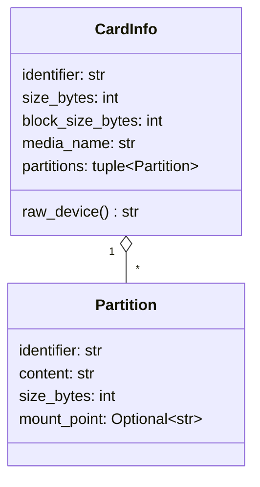
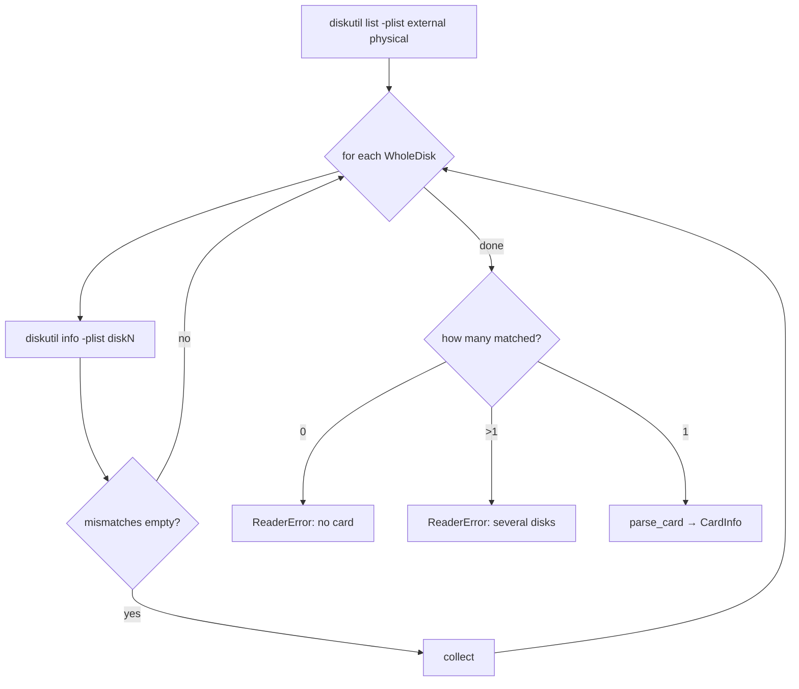

# reader — finding the one card we are allowed to touch

## Why this module exists

Every tool in microsd-utils writes or reads a **raw block device**. On a Mac, `/dev/rdisk0` is the internal SSD; `/dev/rdisk4` might be the SD card today and an external backup drive tomorrow. A single wrong identifier is catastrophic and unrecoverable.

So the project's first rule is absolute: **only the card in one designated card reader may be read or written**. `reader.py` turns that rule into code. It answers exactly one question — *which disk identifier, if any, is the card?* — and it answers it using `diskutil` **metadata only**, without ever opening a device node.

The module is pure apart from an injected adapter, which makes the most safety-critical logic in the project also the most thoroughly tested.

## The fingerprint: identifying hardware, not a disk number

Disk numbers (`disk4`) are assigned in plug-in order and are worthless as identity. Instead, the reader is pinned by properties of the *hardware path*:

- **`IORegistryEntryName`** — the reader chip's name (`NORELSYS 1081CS0 Media`).
- **`DeviceTreePath`** — the exact USB port the reader is plugged into.
- **`BusProtocol`** — `USB`.

These live in a tracked `sd_reader.json` at the repo root, so moving the reader to another port is a deliberate, reviewable edit rather than something the tool silently accepts.

```python
@dataclass(frozen=True)
class Fingerprint:
    registry_name: str
    device_tree_path: str
    bus_protocol: str
```

Pinning to the port as well as the model was a deliberate choice of the strictest option: a second identical reader in another port is *not* accepted.

## Matching: an allow-list expressed as data

The matcher compares a `diskutil info` plist against a dictionary of required key/value pairs: the three fingerprint values plus four structural invariants (whole disk, physical, not internal, removable).

```python
expected = {
    "IORegistryEntryName": fingerprint.registry_name,
    "DeviceTreePath": fingerprint.device_tree_path,
    "BusProtocol": fingerprint.bus_protocol,
    "WholeDisk": True,
    "VirtualOrPhysical": "Physical",
    "Internal": False,
    "RemovableMedia": True,
}
```

Three properties of this design are worth calling out:

- **It returns reasons, not a boolean.** `mismatches()` yields one human-readable line per failed key, so a refusal can say *why* (e.g. `DeviceTreePath is '…port-hs…', expected '…port-ss…'`).
- **Missing keys fail closed.** `info.get(key)` returns `None` for an absent key, which never equals an expected value. An unexpected plist shape is a refusal, not a pass.
- **Redundancy is intentional.** A device on the fingerprinted USB port is almost certainly not internal — but the structural checks cost nothing and guard against a fingerprint file edited by mistake.

This is the *allow-list* pattern: rather than enumerating dangerous disks to avoid (internal, APFS container, boot volume…), it enumerates the one thing that is permitted and rejects everything else.

## Data model

Discovery produces a small, frozen description of the card. Callers never see raw plists.



`raw_device` derives `/dev/rdiskN` from the identifier. The **`r` prefix** matters on macOS: `/dev/diskN` goes through the buffer cache, while `/dev/rdiskN` is the *character* (raw) device — unbuffered, and several times faster for large sequential I/O.

`parse_card` joins two `diskutil` outputs: `info` for the whole-disk properties, and `list -plist` for the partition table. It refuses if the identifier doesn't appear exactly once in the list. One field is optional on purpose:

```python
# A blank card with no partition table has no Partitions key.
for part in entries[0].get("Partitions", [])
```

Everything else is a hard key lookup — a missing `Content` or `Size` raises rather than being defaulted.

## Discovery and the re-check

Discovery is a linear scan over external physical whole disks, collecting every match:



Two design points:

- **Exactly one, or nothing.** Zero matches means the reader is unplugged, empty, or in the wrong port. More than one is impossible with a port-pinned fingerprint — so if it happens, something is badly wrong and the tool stops rather than guess.
- **"No card" has its own exception.** Zero matches raises `NoCardError`, a subclass of `ReaderError`. Most callers treat both alike, but the card-swap wait in `copy` (`11-swap.md`) needs to tell "reader is empty" — an expected state while the user swaps cards — from "two readers match", which must still stop everything.
- **External physical only.** `diskutil list external physical` never lists the internal SSD or APFS synthesized disks, so their metadata is not even queried.

### Time-of-check vs. time-of-use

Discovery runs seconds — or, in a stress test, an hour — before the device is opened. In between, the card could be pulled and `disk4` reassigned to something else. This is the classic **TOCTOU** (time-of-check to time-of-use) race.

`recheck()` narrows that window: it re-queries `diskutil info` for the same identifier immediately before the open, re-runs the matcher, and also compares the **size** — a cheap way to notice that a *different card* is now in the same reader.

```python
info = diskutil.info(card.identifier)
reasons = mismatches(info, fingerprint)
if info.get("Size") != card.size_bytes:
    reasons.append(...)
```

The window can't be closed completely from user space, but it shrinks from minutes to milliseconds.

## Dependency injection via `Protocol`

`discover` and `recheck` take a `DiskutilQueries` object rather than calling `subprocess` themselves:

```python
class DiskutilQueries(Protocol):
    def list_external_physical(self) -> dict: ...
    def info(self, identifier: str) -> dict: ...
```

A `typing.Protocol` is *structural*: anything with those two methods qualifies, no inheritance needed. Production passes the real `Diskutil` adapter; tests pass a fake that returns **plists captured from the real card**, plus variants with one key altered. Every refusal path is therefore exercised without a card in the reader.

## Observations and possible improvements

1. **Fingerprint lookup by port first.** Discovery still runs `diskutil info` on every external disk until one matches. Querying IORegistry by `DeviceTreePath` directly would avoid touching other disks' metadata at all — stricter, but more macOS-specific code.
2. **`FINGERPRINT_PATH` assumes an in-repo install.** It resolves relative to the package's parent directory, which works for `uv sync`'s editable install but would break in a wheel. An env-var override or `--reader-config` flag would make this explicit.
3. **Size is a weak card identity.** Two cards of the same model have the same size. Adding the partition table (or volume UUIDs, when present) to the re-check would catch a same-size swap.
4. **Validate `sd_reader.json` on load.** `Fingerprint(**fields)` raises a `TypeError` on unknown or missing keys; wrapping it in a `ReaderError` with the file path would give a clearer message.
