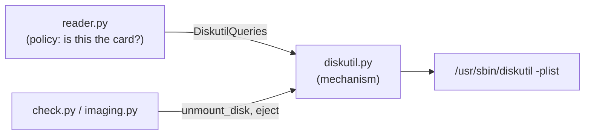

# diskutil — a narrow adapter over macOS's disk tool

## What it does

`diskutil.py` is the *only* place the project shells out to `/usr/sbin/diskutil`. It exposes four operations and nothing more:

- **`list_external_physical()`** — enumerate external physical disks.
- **`info(identifier)`** — properties of one whole disk.
- **`unmount_disk(identifier)`** — unmount all of a disk's volumes before raw I/O.
- **`eject(identifier)`** — release the card after a flash, so it can be pulled safely.

The two state-changing calls share one helper, `run_command(verb, identifier)`, which validates the identifier before running `diskutil <verb> <identifier>`.

It is deliberately thin: no parsing, no policy. The decisions live in `reader.py`; this module just turns a command into a dict.

## Plists, not text

`diskutil` prints human-friendly tables by default, which change between macOS releases. With `-plist` it emits an **Apple property list** — structured XML that Python's standard library parses directly:

```python
def run_plist(args: list[str]) -> dict:
    result = subprocess.run(["diskutil", *args], capture_output=True, check=True)
    return plistlib.loads(result.stdout)
```

- `check=True` turns a non-zero exit into `CalledProcessError`, so a failed query can never be mistaken for an empty answer.
- Arguments are passed as a **list**, never through a shell, so there is no quoting or injection surface.

## The identifier guard

Every method that takes an identifier validates it first:

```python
WHOLE_DISK_RE = re.compile(r"disk\d+")


def require_whole_disk(identifier: str) -> None:
    if not WHOLE_DISK_RE.fullmatch(identifier):
        raise ValueError(...)
```

This rejects partitions (`disk4s1`), paths (`/dev/disk4`), and anything with stray characters. Two details are easy to get wrong:

- **`fullmatch`, not `match` with `^…$`.** In Python regexes, `$` also matches *just before a trailing newline*, so `^disk\d+$` accepts `"disk4\n"`. `fullmatch` requires the whole string to match. (A test pins this down.)
- **Whole disks only.** The tools always operate on the entire card; accepting a partition identifier would be a way to bypass the reader fingerprint, which is checked on the whole disk.

## Where it sits



The class is the concrete implementation of `session.DiskutilCommands` (which extends `reader.DiskutilQueries`); tests substitute a fake with the same method names.

## Observations and possible improvements

1. **Surface `diskutil`'s stderr.** On failure, `CalledProcessError`'s message is just the command and exit code; `diskutil`'s own explanation (e.g. "Unmount failed: resource busy") is captured but dropped. Raising with `result.stderr` included would make failures self-explanatory.
2. **Full path to the binary.** Invoking `/usr/sbin/diskutil` rather than `diskutil` removes any dependence on `PATH`, which matters slightly more once the tool re-runs itself under `sudo`.
3. **No timeout.** A hung `diskutil` (rare, but seen with failing media) hangs the tool. A generous `timeout=` on `subprocess.run` would turn that into a clear error.
