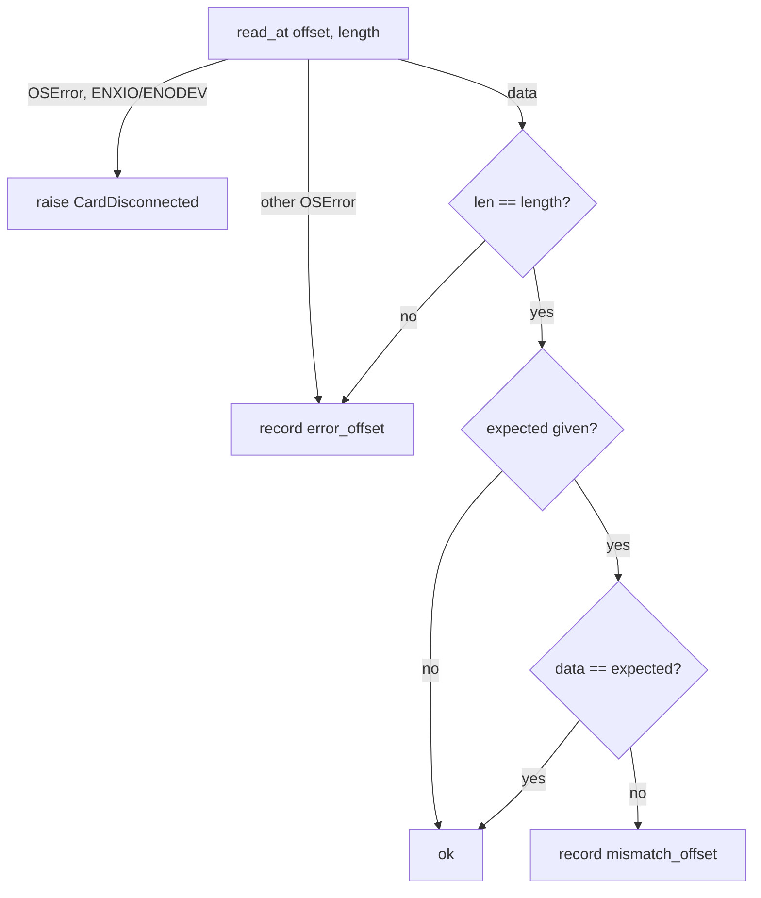
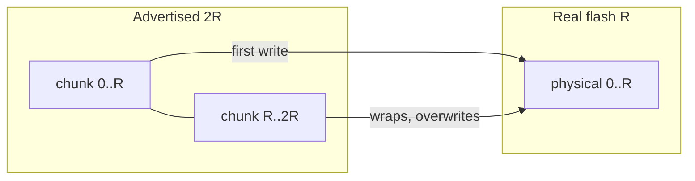

# passes — reading, writing and verifying a whole card

## The job

A health check boils down to touching **every byte** of the card, measuring how long it takes, and noting where things go wrong. `passes.py` does that in fixed-size chunks and returns a `PassResult`:

```python
@dataclass
class PassResult:
    total_bytes: int
    seconds: float
    error_offsets: list[int]  # chunk failed to read / write
    mismatch_offsets: list[int]  # chunk read back different data
```

There are two passes — **read** and **write** — and the destructive check runs them back to back, with the read pass verifying what the write pass laid down.

## Chunking

The card is walked in 4 MiB chunks:

```python
def chunks(size_bytes, chunk_bytes):
    for offset in range(0, size_bytes, chunk_bytes):
        yield offset, min(chunk_bytes, size_bytes - offset)
```

Why 4 MiB?

- **Big enough** that per-call overhead (a syscall, a Python loop iteration) is negligible next to the transfer. At ~70 MB/s that's ~17 chunks a second.
- **Small enough** that one bad region costs only 4 MiB of coverage and progress updates stay smooth.
- **A multiple of every block size** a card will report, so raw-device alignment rules are always met; the final chunk is shorter but still block-aligned because the card's size is.

## One loop, two steps

Both passes share the same skeleton — iterate chunks, do something, report progress, time the whole thing. That skeleton is `timed_pass`; each pass supplies only the per-chunk *step*:

```python
def timed_pass(size_bytes, chunk_bytes, on_progress, step) -> PassResult:
    result = PassResult(total_bytes=size_bytes, seconds=0.0)
    start = time.monotonic()
    for offset, length in chunks(size_bytes, chunk_bytes):
        step(result, offset, length)
        on_progress(offset + length, size_bytes)
    result.seconds = time.monotonic() - start
    return result
```

This is the *template method* pattern done with a callback rather than inheritance. `time.monotonic()` is used because wall-clock time can jump (NTP, sleep) during an hour-long stress test.

### The read step



- **A failed chunk is recorded and skipped** — the pass always reaches the end. A card with one bad region should report *how much* is bad, not stop at the first error.
- **A short read is an error.** On a raw device, fewer bytes than asked means the card stopped responding mid-chunk.

### Bad block or lost card?

"Record and keep going" is right for a bad block and badly wrong for a **card that is no longer there**. On 2026-10-21 the Mac idle-slept 82% into a verify; the USB reader dropped, and every remaining read failed instantly. The pass dutifully recorded 2,740 bad chunks and a healthy card was graded RETIRE.

The two cases differ in their **errno**:

```python
# Errors meaning the device went away, not that a block is bad (EIO).
GONE_ERRNOS = {errno.ENXIO, errno.ENODEV}


def raise_if_gone(error: OSError) -> None:
    if error.errno in GONE_ERRNOS:
        raise CardDisconnected(f"card disconnected: {error}") from error
```

- **`EIO`** — the device answered, but the block is bad: count it, continue.
- **`ENXIO` ("Device not configured") / `ENODEV`** — the device is gone: stop now, with no verdict.

Both passes call `raise_if_gone` first in their `except OSError` block, and so does `random_io.py`. `CardDisconnected` is deliberately **not** an `OSError`, so no handler that records bad blocks can swallow it on the way up.

Which errno macOS actually reports for a pulled USB card is **unverified** until the TF05.7 hardware test; if it differs, only `GONE_ERRNOS` changes.

## The write pattern and fake-capacity cards

The write pass fills each chunk with pseudo-random bytes **seeded by the chunk's offset**:

```python
def pattern(offset: int, length: int) -> bytes:
    return random.Random(offset).randbytes(length)
```

Two properties make this work:

- **Deterministic** — the verify pass can regenerate exactly what should be there without storing 60 GB of expected data.
- **Position-dependent** — every chunk's content is unique to where it was written.

The second property is what catches **fake-capacity cards**. A counterfeit "64 GB" card might hold only 8 GB; its controller maps addresses *modulo* the real size, so writes past 8 GB silently land on top of earlier data.



When verification reads logical offset *o* < R, it gets the data written for *o* + R — a mismatch. Reads of *o* ≥ R map to the same physical block and return the chunk last written there, which *is* the one for *o* — so they match.

The counter-intuitive result: **a fake card fails its early chunks, not its late ones.** A naive "find the last good offset" approach would conclude the card is fine past the point it actually lies. Counting mismatches, wherever they fall, gives the right answer. (This is the same idea behind the well-known `f3` tool.)

Python's `random` (Mersenne Twister) is not cryptographic, and doesn't need to be: the goal is uniqueness per offset, not unpredictability. `randbytes` generates 4 MiB in a few milliseconds.

## Testability

Both passes take plain callables — `read_at(offset, length)` and `write_at(offset, data)` — rather than a device. Tests drive them with an in-memory `FakeCard` that can wrap around (fake capacity), corrupt one chunk, or raise on read, and with a temp file through the real `RawDevice`.

## Observations and possible improvements

1. **Random I/O is a separate module.** Small scattered requests — the workload that reveals wear — are measured by `random_io.py` (`05-random_io.md`), not here.
2. **Queue depth of one.** Each chunk waits for the previous one. Two outstanding reads (a thread pool, or alternating buffers) could hide per-request latency; measured at ~70 MB/s against a UHS-I ceiling of ~90–100 MB/s, the gain is probably 10–20%.
3. **Mismatches aren't classified.** The verdict says "bad blocks or fake capacity". If every mismatch lies in a contiguous prefix, fake capacity is almost certain and the real size can be reported — worth a dedicated message.
4. **Offset lists grow unbounded.** A 1 TB fake card could record ~125 000 offsets. Harmless at today's sizes, but storing ranges would be tidier.
5. **Reuse a buffer.** `os.preadv` into a preallocated `bytearray` would avoid allocating 4 MiB per chunk.
