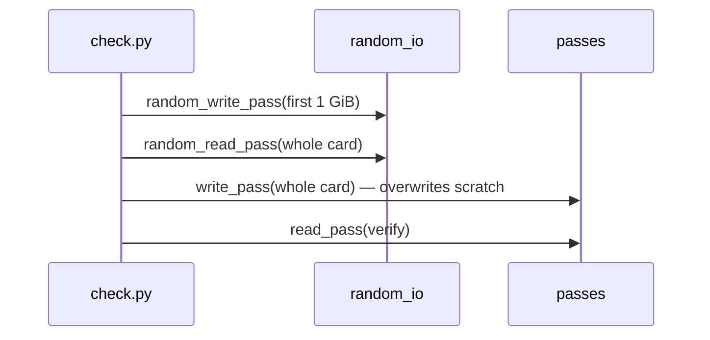

# random_io — small scattered I/O, the Pi's real workload

## Why a second kind of test

The sequential passes in `passes.py` measure **bandwidth**: how fast the card streams megabytes. A Raspberry Pi running from a card does something else entirely. Booting, logging, package updates and databases all issue **small requests at scattered addresses**, typically 4 KB at a time.

These two workloads stress different parts of the card. Flash memory is erased in large blocks (often several MB) but written in small pages, so a 4 KB write into the middle of a used erase block forces the controller to shuffle data around. As a card wears, that housekeeping gets slower — and **random write speed degrades long before sequential speed does**. Without SMART data, this is the best wear signal available.

## The yardstick: A1 and A2

The SD Association defines *Application Performance Classes* for exactly this workload, measured in **IOPS** (I/O operations per second) at 4 KB:

| Class | Random read | Random write |
|---|---|---|
| A1 | 1500 IOPS | 500 IOPS |
| A2 | 4000 IOPS | 2000 IOPS |

`verdict.py` grades against these; this module only measures.

## The measurement

Each pass issues one 4 KB request at a time at random 4 KB-aligned offsets, for a fixed duration (30 s by default), then reports operations per second:

```python
def timed_random_pass(region_bytes, duration_s, clock, operation) -> RandomResult:
    result = RandomResult()
    start = clock()
    measure_from = start + WARMUP_SHARE * duration_s
    for offset in random_offsets(region_bytes):
        now = clock()
        if now - start >= duration_s:
            break
        try:
            operation(offset)
        except OSError as error:
            raise_if_gone(error)
            result.error_offsets.append(offset)
        else:
            result.operations += int(now >= measure_from)
    result.seconds = clock() - measure_from
    return result
```

Design choices worth noting:

- **Time-bounded, not count-bounded.** A fast card and a slow card both take 30 s; the result is the number of operations completed. A count-bounded test would take minutes on a worn card.
- **Queue depth of one.** The A-class spec measures at higher queue depths, so a card may score lower here than on its label. The comparison is still meaningful *between runs of this tool*, and a worn card drops regardless.
- **Failed operations aren't counted as throughput** — they're recorded as errors, which `verdict.py` treats as RETIRE. The exception is a card that has disappeared: `raise_if_gone` (from `passes.py`, see `04-passes.md`) stops the pass instead of recording thousands of instant failures.

## The warm-up

On the real test card, `iostat` showed a **cold card running ~7% slower for its first ~8 s** (about 1,395 tps), then settling near 1,510. A card that has just been idle, or a reader waking from a low-power state, would otherwise drag the average down.

So the first **`WARMUP_SHARE` (20%) of each pass is warm-up**:

- **Operations** in the warm-up are issued but not counted.
- **Time** is measured from `measure_from`, so IOPS = counted operations / counted seconds.
- **Errors** are still recorded. A failure is a failure whenever it happens; the warm-up only discounts *speed*.

```mermaid
gantt
    dateFormat s
    axisFormat %S s
    section 30 s pass
    warm-up (errors count, ops don't) :a, 0, 6s
    measured window (IOPS)            :b, after a, 24s
```



Making the warm-up a *share* of the duration rather than a fixed 5 s keeps the run at 30 s total and lets tests with a 0.01 s fake pass behave the same way.

## Reproducible randomness

```python
def random_offsets(region_bytes, seed=SEED):
    rng = random.Random(seed)
    blocks = region_bytes // BLOCK_BYTES
    while True:
        yield rng.randrange(blocks) * BLOCK_BYTES
```

A fixed seed means every run visits the same sequence of addresses, so two runs on the same card are comparable. Picking a **block index** and multiplying guarantees alignment: an unaligned 4 KB request would straddle two flash pages and measure something else.

## Where random writes are allowed

Random **reads** run over the whole card in both modes — they're harmless.

Random **writes** run only in destructive mode, confined to a **1 GiB scratch region** at the start of the card, and *before* the full write pass, which then overwrites it:



Writes use one pre-generated block of pattern data, so generating bytes never costs IOPS.

## Testing without waiting

The clock is injected. Tests pass a `TickingClock` that advances 1 ms per read, so a "1 second" pass runs about 1000 operations instantly — about 800 of them counted after the warm-up — and the IOPS arithmetic is checked exactly. A separate test fails every read and checks that warm-up failures are still recorded.

## Observations and possible improvements

1. **Python overhead is negligible — measured.** The loop alone runs at 0.2–0.7 µs per op; a 4 KB read at A1 rates takes ~667 µs, so the interpreter adds ~0.1%. `iostat` showed the same ~1,500 tps the tool reported.
2. **Higher queue depth** (a few threads issuing requests) would match the A-class test conditions and let cards that support command queuing show it.
3. **Latency percentiles.** A card averaging A1 but with occasional 500 ms stalls feels terrible on a Pi. Recording the slowest 1% of operations would catch it.
