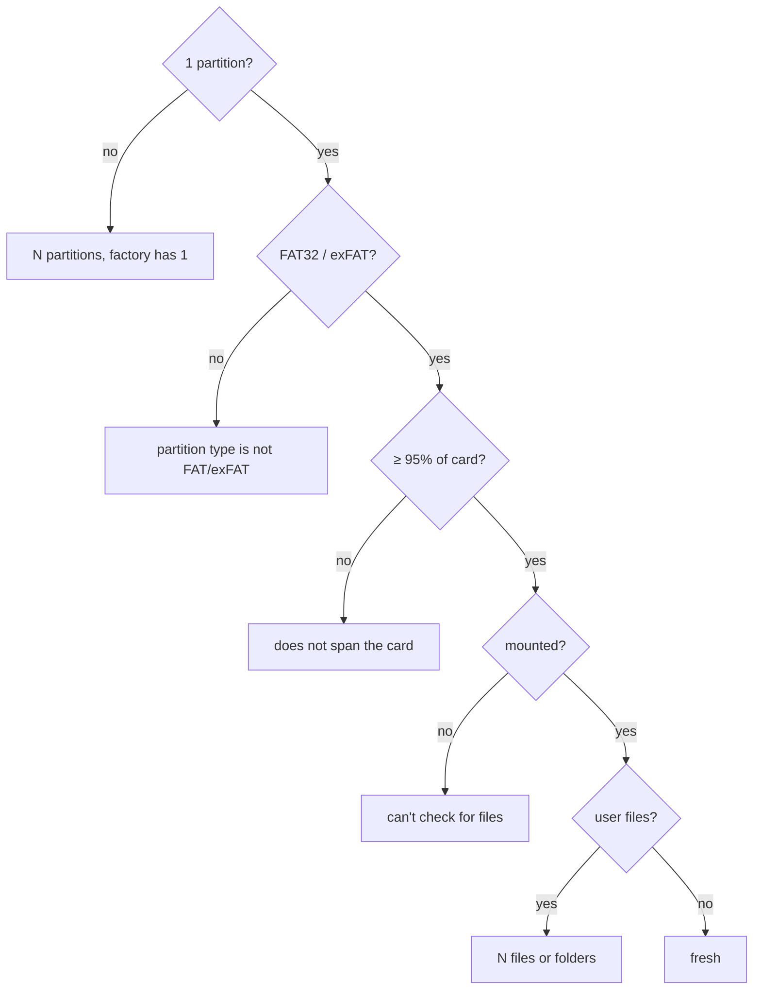

# freshness — does this card look unused?

## The problem

The tool promises a verdict of *brand new*, *still OK* or *retire*. Errors and speed separate "retire" from the rest — but nothing on the card says how much it has been used. SSDs keep SMART wear counters; microSD cards behind this USB reader report `SMARTStatus: Not Supported` (checked 2026-10-18).

So "brand new" has to be **inferred from appearance**: does the card still look the way it left the factory?

## The heuristic

A factory card has a recognisable shape:

1. **Exactly one partition.**
2. **FAT32 or exFAT** — the SD Association mandates FAT32 for SDHC (≤ 32 GB) and exFAT for SDXC (> 32 GB).
3. **Spanning (almost) the whole card.** Manufacturers start the partition a few MB in, aligned to the flash erase block, so ≥ 95% is the test.
4. **No files** beyond what macOS creates itself on mount.

`assess` checks these in order and returns at the first failure, carrying the reason:



A Raspberry Pi card — like the one tested on 2026-10-18 — fails at the first step: it has a FAT boot partition and a Linux root partition.

## Partition type names

`diskutil` reports MBR partition types by name, and one quirk needs a comment in the code:

```python
# On MBR, exFAT uses the same type byte as NTFS, so diskutil reports it as Windows_NTFS.
FACTORY_CONTENTS = {"DOS_FAT_32", "Windows_FAT_32", "Windows_NTFS"}
```

MBR type `0x07` is shared by NTFS and exFAT; the partition table alone can't tell them apart. Accepting `Windows_NTFS` therefore admits a factory exFAT card — and also an NTFS-formatted one, a harmless false positive since no card ships with NTFS.

## Ignoring macOS's own files

Mounting a FAT volume on a Mac immediately creates `.Spotlight-V100`, `.fseventsd`, `.Trashes` and AppleDouble `._*` files. Without filtering, *no* card could ever look fresh after being inserted:

```python
user_files = [
    name
    for name in top_level_names
    if name not in MACOS_MOUNT_FILES and not name.startswith("._")
]
```

`System Volume Information` is in the list for the same reason — Windows creates it.

## A signal, not a verdict

`assess` returns a `Freshness(is_fresh, reason)` and decides nothing. `verdict.py` turns it into the separate *Looks brand new* note; it never changes the grade (`07-verdict.md`). In destructive mode, `check.py` takes this reading **before** the write pass, because afterwards the card holds only test pattern.

## Observations and possible improvements

1. **The `Windows_NTFS` name is unconfirmed on a real factory exFAT card.** The first fresh SDXC card checked should confirm it; if `diskutil` reports something else, `FACTORY_CONTENTS` needs it.
2. **Only the top level is inspected.** A card with an empty `DCIM/` folder (some cameras create one on insertion) reads as used. That's probably the right call, but worth knowing.
3. **Freshness can be faked by reformatting.** A worn card freshly formatted looks brand new. The verdict is honest about being an estimate, but the report could say "looks factory-fresh" rather than "brand new".
