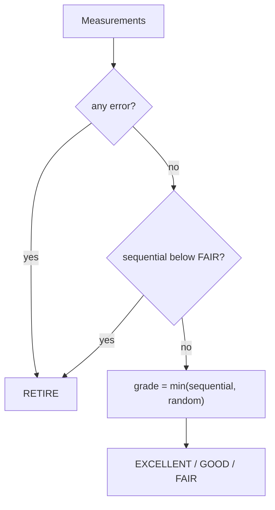

# verdict — grading a card from what we measured

## What it decides

`verdict.py` turns the health check's measurements into one of four grades, with the reasons behind it:

```python
class Grade(IntEnum):
    RETIRE = 0
    FAIR = 1
    GOOD = 2
    EXCELLENT = 3
```

Using an **`IntEnum`** ordered from worst to best is the key trick: combining grades becomes `min(a, b)`. The module is pure — no I/O, no clock — so every threshold is tested exhaustively.

## Inputs

All measurements travel together in one frozen dataclass:

```python
@dataclass(frozen=True)
class Measurements:
    read: PassResult
    write: PassResult | None  # None in read-only mode
    random_read: RandomResult
    random_write: RandomResult | None  # None in read-only mode
```

`is_read_only` is derived from `write is None`, so it can't disagree with the data.

## The decision



### Errors always retire

Any chunk that failed to read or write, any chunk that read back wrong, any failed random operation: RETIRE. A card costs a few dollars; a corrupted Pi system costs an afternoon. `errors()` lists *all* of them so the user sees the full picture.

### Sequential tiers

Anchored on the SD **speed classes**: U1 promises 10 MB/s sustained write, U3/V30 promises 30 MB/s.

| Grade | Write | Read |
|---|---|---|
| EXCELLENT | ≥ 30 MB/s | ≥ 60 MB/s |
| GOOD | ≥ 20 | ≥ 40 |
| FAIR | ≥ 10 | ≥ 20 |
| below FAIR | → RETIRE | |

### Random tiers

Anchored on the **A1/A2 application classes** (see `05-random_io.md`):

```python
RANDOM_TIERS = [
    RandomTier(Grade.EXCELLENT, "A2", 4000, 2000),
    RandomTier(Grade.GOOD, "A1", 1500, 500),
    RandomTier(Grade.FAIR, "below A1", 0, 0),
]
```

The last tier has zero thresholds, so it **matches everything**. That's a *sentinel* — it lets `random_tier` be a single `next(...)` with no "not found" case, and it encodes a policy decision in data: **slow random I/O caps a card at FAIR but never retires it**. Many perfectly working cards predate the A1 class; they're sluggish as a Pi system disk, not broken.

### The reader margin

The A-class numbers are measured in an SD host. This tool reaches the card through a **USB reader, one request at a time**, and each 4 KB read is a full USB round trip. The 64 GB test card measured **~1,500 IOPS ±2%** — exactly on the A1 line, so the bare threshold flipped it between GOOD and FAIR on noise.

The fix keeps the spec numbers in the table and applies a margin at comparison time:

```python
READER_MARGIN = 0.95


def meets(iops: float, min_iops: float) -> bool:
    return iops >= READER_MARGIN * min_iops
```

- **The table still reads like the spec** (1500 / 500, 4000 / 2000), so it can be checked against the SD Association's numbers at a glance.
- **One helper** serves `random_tier`, `read_a_class` and `write_a_class`, so the grade and the `(A1)` labels in the report can never disagree.
- **Borderline cards lean toward the better grade** — a deliberate bias. A card within 5% of A1 (≥ 1,425 read, ≥ 475 write) is an A1 card seen through a USB reader, not a worn one.

### Tier tables as `NamedTuple`s

Both tables are lists of named tuples, best first, scanned top-down for the first tier the card meets. Named fields (`tier.min_write_mb_s`) keep the comparisons readable, and adding a tier is a one-line data change.

## Read-only mode

Without a write pass there's no write speed and no random-write IOPS. Each tier check treats a missing write as "passes": `write is None or write.mb_per_s >= tier.min_write_mb_s`. The grade therefore rests on reads alone, and the `Verdict` carries `is_read_only` so the report says `(read-only: write not measured)`.

## Brand new is a note, not a grade

Freshness (`06-freshness.md`) doesn't change the grade. It sets `is_brand_new`, printed as a separate `Looks brand new` line, and contributes a reason (`not brand new: 2 partitions, factory has 1`). A brand-new card can still be FAIR — a new but slow card is still slow.

## Observations and possible improvements

1. **One card calibrated the margin.** 5% fits the test card's ±2% spread with room to spare; more cards (and a native SD slot for comparison) would show whether the reader's penalty is constant or card-dependent.
2. **The label isn't known.** A card sold as V30 that measures 22 MB/s is GOOD here but underperforming. A `--rated-speed` option would let the verdict compare against the label.
3. **Severity within RETIRE.** One bad chunk and a dying card get the same grade; the share of bad chunks would help the user judge.
