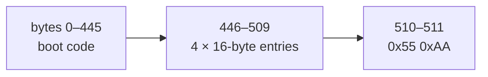

# partitions — where does the data end?

## The problem

A Raspberry Pi OS card on a 64 GB card typically holds a few GB of partitions followed by tens of GB of nothing. Backing up all 64 GB wastes time and disk space, and — worse — produces an image that won't fit a 63.9 GB card from another brand.

So backup copies only **up to the end of the last partition**. To find that point, `partitions.py` reads the card's own partition table — the same structure the Pi's bootloader reads.

## Two table formats

### MBR (Master Boot Record)

The classic PC format, used by Pi OS and by factory-formatted cards. It lives in the first 512-byte sector:



Each 16-byte entry holds a **type byte** at offset 4 and two little-endian 32-bit numbers at offset 8: the **starting sector** and the **sector count**. The data ends at the largest `start + count`:

```python
for index in range(4):
    entry = sector0[446 + 16 * index : 446 + 16 * (index + 1)]
    part_type = entry[4]
    start_lba, sectors = struct.unpack_from("<II", entry, 8)
```

**Extended partitions** (type 0x05/0x0F) hold further *logical* partitions in a chain elsewhere on the disk. The code doesn't walk that chain, and doesn't need to: the extended partition's own entry spans all its logical partitions, so its end is already the end of the data.

### GPT (GUID Partition Table)

The modern format. For compatibility, a GPT disk starts with a *protective MBR* holding a single entry of type **0xEE** spanning the disk. The real table is in block 1:

- `"EFI PART"` signature;
- at offset 72: the block where the entry array starts, the number of entries, and the size of each.

Each entry's **last LBA** (offset 40, 64-bit) marks its final block; an entry whose 16-byte type GUID is all zeros is unused.

## No table, and a corrupt table

The function has three outcomes, and the distinction matters:

| Card | Result | Backup does |
|---|---|---|
| Valid MBR or GPT | end offset in bytes | copy to there |
| No `0x55AA` signature | `None` | copy the whole card |
| Table points past the card, or GPT header missing | `PartitionError` | refuse |

A blank card (or one wiped by `make stress`) has no table, and copying it whole is correct. A table that claims partitions beyond the card's end is *corrupt*; guessing a length would produce a broken image, so the code refuses and says why.

## Reading enough

Backup reads the first **1 MiB** of the card before parsing. That covers the MBR, the GPT header, and the standard 128 × 128-byte GPT entry array (16 KiB starting at block 2). If a GPT's entry array claims to extend beyond what was read, that's reported rather than silently truncated.

## Naming regions of a card

`verify` needs the opposite question: not where the data *ends*, but which partition a given byte belongs to. `regions` answers it from the image's own MBR:

```python
def region_of(entries, offset, block_bytes) -> Region:
    for number, (part_type, start_lba, sectors) in enumerate(entries, 1):
        if start_lba * block_bytes <= offset < (start_lba + sectors) * block_bytes:
            return Region(f"partition {number} ({TYPE_NAMES...})", part_type in FAT_TYPES)
    ...  # before the first partition: "partition table"; else "outside any partition"
```

`Region` is a frozen dataclass, so it can be a `Counter` key. Each differing chunk arrives as a *span* — its first and last differing byte — and counts once in each region those two bytes fall in:

```python
for first, last in spans:
    # dict.fromkeys, not a set: drops a repeat but keeps first-byte order.
    touched = dict.fromkeys([region_of(..., first, ...), region_of(..., last, ...)])
    counts.update(list(touched))
```

Two details earned their comments the hard way:

- **Not a set.** A set of two `Region`s iterates in hash order, and string hashes are randomized per process, so the report's lines came out in a different order from run to run — a flaky test. `dict.fromkeys` de-duplicates and keeps insertion order.
- **A list, not the dict.** `Counter.update` treats a mapping as *counts to add*, so passing the dict (whose values are all `None`) breaks; passing its keys as a list counts each once.

`FAT_TYPES` (0x01, 0x04, 0x06, 0x0B, 0x0C, 0x0E) marks a region as FAT, which is what lets `verify` say "all differences are in the FAT boot partition".

## Observations and possible improvements

1. **"Superfloppy" FAT volumes.** A FAT filesystem written directly at sector 0 (no partition table) also ends in `0x55AA`. Its boot code would be misread as partition entries; the result is almost certainly a "past the card" refusal rather than a wrong copy, but detecting a FAT boot sector (`0xEB` jump, `FAT` string) and copying the whole card would be friendlier.
2. **The GPT backup header is not copied.** GPT keeps a second copy of the table in the disk's last blocks; copying only to the last partition drops it. Linux repairs this silently; macOS may warn. Pi OS uses MBR, so this only matters for GPT cards.
3. **Sector size is the card's block size.** MBR sector numbers are in logical blocks; every microSD card reports 512, but the code takes the block size as a parameter rather than assuming it.
4. **`regions` reads MBR only.** On a GPT card every difference lands in "partition 1 (GPT)", the protective entry; naming GPT partitions would need the entry array, as `gpt_end_block` already reads.
