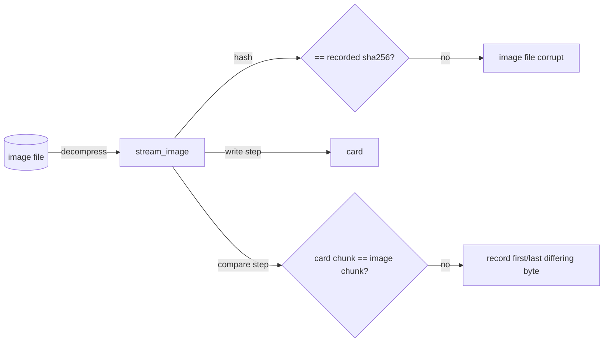

# transfer — moving bytes between card and image, with proof

## The two directions

- **Backup**: card → image. Find where the data ends, stream that many bytes into the compressed image, hashing as they pass.
- **Flash**: image → card. Check the image fits, stream it onto the card hashing as it goes, then read the same range back and compare it with the image chunk by chunk.
- **Verify**: the read-back half of flash on its own, read-only — `compare_card`.

Both stream in the same 4 MiB chunks as `passes.py`, and both take plain `read_at` / `write_at` callables, so tests run them against in-memory fake cards.

## Hashing on the fly

SHA-256 is computed **incrementally** — each chunk is fed to the digest as it passes:

```python
digest = hashlib.sha256()
for offset, length in chunks(length_bytes, CHUNK_BYTES):
    data = read_exactly(read_at, offset, length)
    digest.update(data)
    stream.write(data)
```

This costs one pass over the data instead of two, and memory stays at one chunk regardless of card size. SHA-256 on a modern Mac runs at well over 1 GB/s, so it never slows a card that moves 70 MB/s.

`read_exactly` turns a short read into an `OSError`. A backup with a hole in it is worse than no backup, so — unlike the health check, which records bad chunks and continues — a transfer **stops at the first error**, and the image store deletes the partial file.

## One image stream, two uses

Writing and comparing both walk the decompressed image in chunks and both must check the image against its recorded size and hash. That loop is written once:

```python
def stream_image(source, on_progress, step) -> PassResult:
    with open_image(source.path) as stream:
        while data := stream.read(CHUNK_BYTES):
            step(offset, data)
            digest.update(data)
            ...
    if offset != source.data_bytes or digest.hexdigest() != source.sha256:
        raise TransferError("... the image file may be corrupt")
```

`write_image` passes a step that writes the chunk; `compare_card` passes one that reads the same range from the card and compares. Both therefore catch an image file that has rotted since the backup.



## Comparing, not hashing, the card

The first version hashed what it read back and compared one digest. That answers *whether* the card matches, not *where*. After a reader reset on 2026-10-21, macOS auto-mounted R2's `bootfs`, which changes a few bytes; one hash couldn't tell that from a bad flash, and the only way out was a 35-minute re-flash.

`compare_card` compares each chunk against the image instead, and for each chunk that differs records its **first and last differing byte**:

```python
def difference_span(card: bytes, image: bytes) -> tuple[int, int]:
    card_view, image_view = memoryview(card), memoryview(image)
    low, high = 0, len(card)
    while high - low > 1:  # invariant: equal before low, differ before high
        mid = (low + high) // 2
        if card_view[low:mid] == image_view[low:mid]:
            low = mid
        else:
            high = mid
    ...  # mirror image of the same search for the last byte
```

This is a *binary search over prefixes*: each step compares one half with a single C-level `memoryview` equality (no copying), so a 4 MiB chunk needs about 22 comparisons each way. A Python byte loop would be 4 million iterations per differing chunk — fine for a handful, ruinous for a card that differs everywhere.

**Why bytes, not chunk starts.** Pi images don't put `bootfs` on a chunk boundary: `dome-2-master`'s FAT32 starts at 1 MiB, so chunk 0 holds the MBR *and* the FAT boot sector and tables. Labelled by its start, that chunk read as "partition table" and hid the "only FAT changed" verdict. Labelled by where its bytes actually differ (`partitions.regions`, `08-partitions.md`), it reads as FAT32.

`difference_lines` turns the spans into the report: `Differs: N of M chunks`, one line per partition touched, and the FAT-only note.

## A lost reader is not a bad block

```python
def unless_gone(action: Callable[[], T]) -> T:
    try:
        return action()
    except OSError as error:
        raise_if_gone(error)
        raise
```

Every card read and write in a transfer goes through `unless_gone`. An `ENXIO`/`ENODEV` (the reader dropped off USB) becomes `CardDisconnected` — "card disconnected" — instead of the raw `[Errno 6] Device not configured` the first R2 flash printed. Any other `OSError` propagates unchanged, and a transfer still stops at the first error.

## Up-front refusals

`check_fits` runs **before** the user is asked to confirm, so nothing is erased for a flash that can't succeed:

- the image is larger than the card;
- the image size isn't a whole number of card blocks. Raw devices only accept block-sized writes, and padding would silently change the data being verified.

## Observations and possible improvements

1. **Verify reads the whole range again**, and decompresses the image a second time to compare against. That nearly doubles flash time (17 + 14 min for 64 GB). It's the right default for a tool whose purpose is reliable copies, but a `--no-verify` for re-flashing known-good cards in bulk could be justified later.
2. **Sparse writes.** Pi images are mostly zeros. Skipping all-zero chunks that the card already holds as zeros could halve flash time — but only after a read to check, and "already zero" is not guaranteed on used cards.
3. **Progress shows percent, not ETA.** The same improvement suggested for `check.py` applies here.
