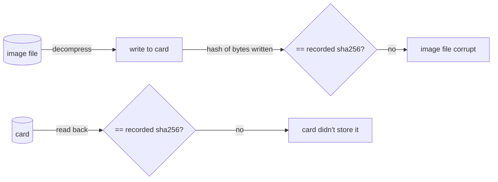

# transfer — moving bytes between card and image, with proof

## The two directions

- **Backup**: card → image. Find where the data ends, stream that many bytes into the compressed image, hashing as they pass.
- **Flash**: image → card. Check the image fits, stream it onto the card hashing as it goes, then read the same range back and hash again.

Both stream in the same 4 MiB chunks as `passes.py`, and both take plain `read_at` / `write_at` callables, so tests run them against in-memory fake cards.

## Hashing on the fly

SHA-256 is computed **incrementally** — each chunk is fed to the digest as it passes:

```python
digest = hashlib.sha256()
for offset, length in chunks(length_bytes, CHUNK_BYTES):
    data = read_exactly(read_at, offset, length)
    digest.update(data)
    stream.write(data)
```

This costs one pass over the data instead of two, and memory stays at one chunk regardless of card size. SHA-256 on a modern Mac runs at well over 1 GB/s, so it never slows a card that moves 70 MB/s.

`read_exactly` turns a short read into an `OSError`. A backup with a hole in it is worse than no backup, so — unlike the health check, which records bad chunks and continues — a transfer **stops at the first error**, and the image store deletes the partial file.

## Two hashes on flash

Flash checks the same expected hash twice, catching two different failures:



- **Written ≠ recorded**: the image file on the Mac has rotted or been truncated since the backup. The card now holds bad data, and the error says so.
- **Read back ≠ recorded**: the card accepted the writes but returns something else — a failing or fake card.

Only when both match does flash print `Verified: OK`.

## Up-front refusals

`check_fits` runs **before** the user is asked to confirm, so nothing is erased for a flash that can't succeed:

- the image is larger than the card;
- the image size isn't a whole number of card blocks. Raw devices only accept block-sized writes, and padding would silently change the data being verified.

## Observations and possible improvements

1. **Verify reads the whole range again.** That doubles flash time. It's the right default for a tool whose purpose is reliable copies, but a `--no-verify` for re-flashing known-good cards in bulk could be justified later.
2. **Sparse writes.** Pi images are mostly zeros. Skipping all-zero chunks that the card already holds as zeros could halve flash time — but only after a read to check, and "already zero" is not guaranteed on used cards.
3. **Progress shows percent, not ETA.** The same improvement suggested for `check.py` applies here.
