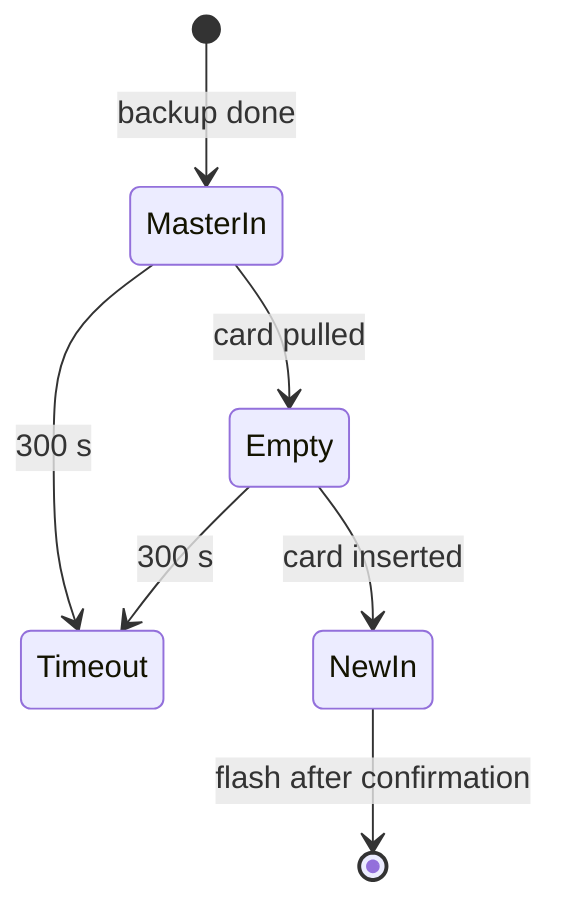

# swap — waiting for a human to change cards

## The situation

`copy` uses one reader for two cards. After backing up the master, it must:

1. wait for the master to be **pulled out**;
2. wait for a new card to be **pushed in**;
3. only then flash.

The order is a safety property. If the tool accepted "a card is present" as the new card, a user who hadn't yet swapped would have the **master** erased with its own image. Requiring an observed *absence* in between makes that impossible.

## Polling with the normal discovery

There's no notification API in use here; the module simply asks, once a second, *what's in the reader?* — using exactly the same fingerprint discovery as every other command:

```python
def card_poll(diskutil, fingerprint) -> Poll:
    def poll():
        try:
            return discover(diskutil, fingerprint)
        except NoCardError:
            return None

    return poll
```

`NoCardError` (a subclass of `ReaderError`) is the only refusal translated to "no card". Every other discovery error — such as two matching readers — still propagates and stops the copy.

## One loop, two predicates

```python
def wait_until(poll, is_done, waiting_for, clock, sleep):
    deadline = clock() + SWAP_TIMEOUT_SECONDS
    while True:
        card = poll()
        if is_done(card):
            return card
        if clock() >= deadline:
            raise SwapError(...)
        sleep(POLL_SECONDS)
```

`wait_for_removal` and `wait_for_insert` are this loop with `card is None` and `card is not None`. A five-minute timeout keeps an abandoned copy from polling forever.



## Why the master is unmounted, not ejected

Ejecting would make macOS drop the card from `diskutil` *while it's still physically in the reader*. The removal wait would then succeed instantly, defeating its purpose. Unmounting keeps the disk visible until the card is really pulled.

## Testing

Clock and sleep are injected. A `Script` fake replays a sequence of poll results and advances time one interval per sleep, so a five-minute timeout is tested in microseconds and the exact number of polls can be asserted.

## Observations and possible improvements

1. **Unverified assumption:** that this USB reader's disk disappears from `diskutil` when the card is pulled. Some readers keep a zero-size "no media" disk instead. TF02.9 checks this; if it fails, a size-zero card must count as "no card".
2. **The same physical master can come back.** If the user pulls the master and re-inserts it, the tool can't tell. `copy` prints a CAUTION when the new card's layout matches the master's, and the two-step confirmation shows the card again — but the final defence is the human.
3. **Event-driven waiting** (DiskArbitration callbacks) would react instantly instead of within a second, at the cost of macOS-specific bindings.
