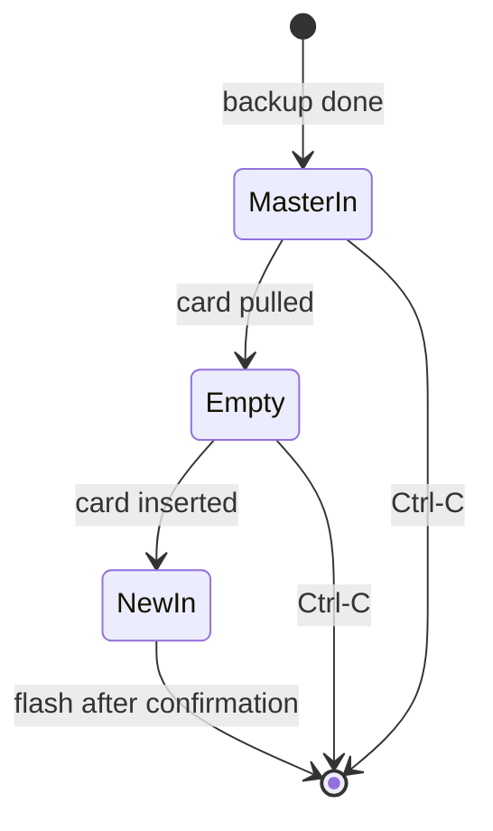

# swap — waiting for a human to change cards

## The situation

`copy` uses one reader for two cards. After backing up the master, it must:

1. wait for the master to be **pulled out**;
2. wait for a new card to be **pushed in**;
3. only then flash.

The order is a safety property. If the tool accepted "a card is present" as the new card, a user who hadn't yet swapped would have the **master** erased with its own image. Requiring an observed *absence* in between makes that impossible.

## Polling with the normal discovery

There's no notification API in use here; the module simply asks, once a second, *what's in the reader?* — using exactly the same fingerprint discovery as every other command:

```python
def card_poll(diskutil, fingerprint) -> Poll:
    def poll():
        try:
            return discover(diskutil, fingerprint)
        except NoCardError:
            return None

    return poll
```

`NoCardError` (a subclass of `ReaderError`) is the only refusal translated to "no card". Every other discovery error — such as two matching readers — still propagates and stops the copy.

## One loop, two predicates

```python
def wait_until(poll, is_done, sleep):
    while not is_done(card := poll()):
        sleep(POLL_SECONDS)
    return card
```

`wait_for_removal` and `wait_for_insert` are this loop with `card is None` and `card is not None`.

### No timeout, on purpose

The first version gave up after five minutes. On the first real `copy` (2026-10-22) that was the wrong call: the backup before the swap takes about 17 minutes, the user had walked away, and the copy died with the image saved but no card flashed. A human-paced step shouldn't have a machine-paced deadline, so the wait now lasts until the swap happens or the user presses **Ctrl-C** — and the prompts say so: `(Waiting as long as it takes; Ctrl-C to stop.)`.



## Why the master is unmounted, not ejected

Ejecting would make macOS drop the card from `diskutil` *while it's still physically in the reader*. The removal wait would then succeed instantly, defeating its purpose. Unmounting keeps the disk visible until the card is really pulled.

## Testing

Sleep is injected. A `Script` fake replays a sequence of poll results and advances a virtual clock one interval per sleep, so "still waiting after two hours" is tested in microseconds — 7,200 polls of a card that stays put, then the swap — and the exact number of polls can be asserted.

## Observations and possible improvements

1. **Confirmed on hardware:** this USB reader's disk does disappear from `diskutil` when the card is pulled, and the new card comes back as the same `disk4` (TF02.9, 2026-10-22). Readers that keep a zero-size "no media" disk would need a size-zero card to count as "no card".
2. **The same physical master can come back.** If the user pulls the master and re-inserts it, the tool can't tell. `copy` prints a CAUTION when the new card's layout matches the master's, and the two-step confirmation shows the card again — but the final defence is the human.
3. **Event-driven waiting** (DiskArbitration callbacks) would react instantly instead of within a second, at the cost of macOS-specific bindings.
