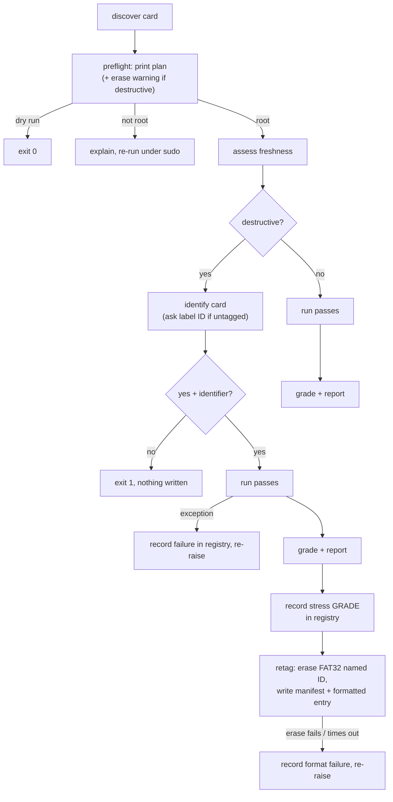

# check — the health check, end to end

## Overview

`check.py` runs `microsd check` (`make validate`, `make stress`). It doesn't read cards, grade results or prompt users itself — it sequences the modules that do, with safety gates in between. Its entry point returns a process exit code:

```python
def run_check(env: Env, is_destructive: bool, is_dry_run: bool) -> int:
```

**0** for EXCELLENT / GOOD / FAIR, **2** for RETIRE, **1** for an error or refusal.

## The flow



Before the plan, both modes print the card's **ID line** from `peek` (see `17-identity.md`). Read-only mode never writes the manifest; it only reports the ID or says the card is untagged.

`preflight` and `confirmed_erase` live in `session.py` (see `12-session.md`), shared with `backup`, `flash` and `copy`. What's specific to `check` is the plan text, the passes, and the report.

Two ordering choices are load-bearing:

- **Freshness before passes.** Destructive mode unmounts and overwrites the volume; after that there's nothing left to inspect.
- **Everything that can refuse comes before any device is opened.**
- **Identify before the erase questions.** The user sees "this is card A1" (or is asked for the label) *before* typing `yes`, which is the moment a mixed-up card gets caught.

### Keeping the card's identity through a wipe

A stress run overwrites every block, manifest included. `run_check` therefore reads the manifest first, and after the report it **records the verdict straight away** — `stress <GRADE>`, contents `empty` — in the registry. Only then does `retag`:

1. re-check the reader, then `erase_fat32(card, ID)` — the card gets a fresh FAT32 volume named after its label;
2. re-discover the card, so the new partition is known;
3. write the manifest back with a `formatted FAT32` entry.

**Why the verdict comes first.** Formatting talks to the card again, and a failing card can hang it. Originally the verdict was only saved at the very end, inside `retag`, so a hung format (card R3) lost a 35-minute result. Now the history reads `stress` → `formatted`, and a format that raises or times out adds `formatted failed: <error>` before re-raising.

All three registry writes go through one helper, `identity.record_event` — shared with `flash` and `copy`, which record their own failures the same way (`14-imaging.md`):

```python
def record_event(env, manifest, kind, detail, contents=None) -> Manifest:
    updated = manifest.with_event(event(env, kind, detail), contents)
    env.registry.record(updated, stamp(env))
    return updated
```

If the passes themselves raise — a device error, or `CardDisconnected` when the card drops off USB — `stress_passes` records `stress failed: <error>` and re-raises. No verdict is printed, so a lost card can't masquerade as a RETIRE.

## The passes

```python
def run_passes(env, card, is_destructive) -> Measurements:
    if not is_destructive:
        with env.open_device(card, False) as device:
            random_read = run_random_read(env, device, card)
            read = read_pass(device.read_at, size_bytes, on_read)
        return Measurements(read, None, random_read, None)
    env.diskutil.unmount_disk(card.identifier)
    with env.open_device(card, True) as device:
        random_write = random_write_pass(device.write_at, scratch_bytes, ...)
        random_read = run_random_read(env, device, card)
        write = write_pass(device.write_at, size_bytes, on_write)
        read = read_pass(device.read_at, size_bytes, on_verify, pattern)
    return Measurements(read, write, random_read, random_write)
```

| Mode | Order | Approx. time, 64 GB |
|---|---|---|
| read-only | random reads (30 s) → full read | ~16 min |
| destructive | random writes in first 1 GiB (30 s) → random reads (30 s) → full write → full verify | ~36 min |

The random tests go **first**: they're short, and in destructive mode the random writes land in a scratch region the full write pass overwrites anyway. Everything happens through one `open_card` handle, so the fingerprint re-check happens once, immediately before I/O.

## The report

```
Write   : 62,600 MB in 1160 s, 54.0 MB/s, 0 bad chunks
Verify  : 62,600 MB in 870 s, 72.0 MB/s, 0 bad chunks
Random  : read 2,340 IOPS (A1), write 610 IOPS (A1)
Verdict: GOOD
  - sequential: EXCELLENT (write 54.0 MB/s, read 72.0 MB/s)
  - random: GOOD (A1 level)
  - not brand new: 2 partitions, factory has 1
```

Each random direction gets its own A-class label (`read_a_class`, `write_a_class`), because a card can read at A2 but write below A1. The verdict line adds `(read-only: write not measured)` when applicable, and `Looks brand new` follows it for a factory-fresh card.

## Testing

`tests/test_check.py` runs the whole flow against `make_test_env` fakes. The most valuable assertions are negatives and orderings:

- read-only mode never writes, never unmounts;
- every wrong confirmation (eight variants) writes nothing;
- the erase warning precedes both questions and the password prompt;
- random writes stay inside the scratch region and finish before the first full-pass write;
- each grade maps to the right exit code.

## Observations and possible improvements

1. **No ETA.** A 36-minute stress test shows percentages only; MB/s and time remaining on the progress line would answer the user's first question.
2. **Ctrl-C mid-stress** leaves the card in an undefined state without saying so, and records nothing; treating `KeyboardInterrupt` like the other pass failures would put it in the history.
3. **The card and plan print twice** (before and after sudo). Harmless, and doubles as confirmation, but could be suppressed in the elevated run.
