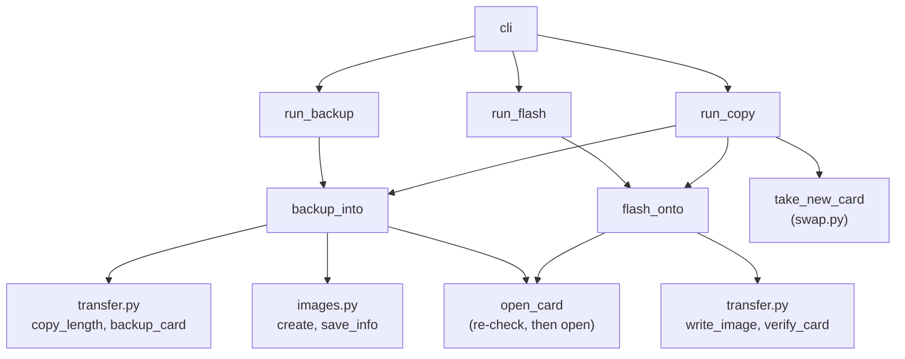
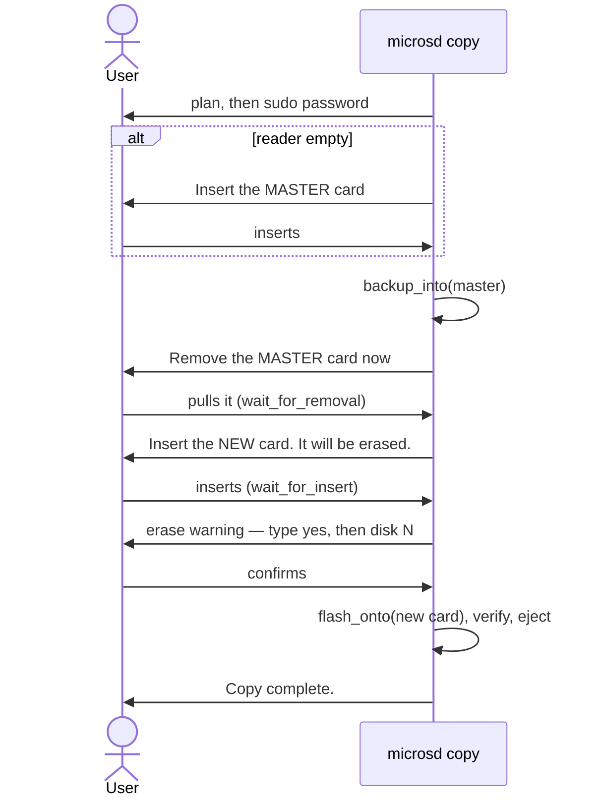

# imaging — backup, flash and copy

## Three commands, two building blocks

`imaging.py` composes the lower layers into three user-facing commands. Most of the work is in two helpers:

- **`backup_into(env, card, name)`** — unmount, find the data end, stream into a new image, save the sidecar.
- **`flash_onto(env, card, source)`** — unmount, write, verify, eject.

`backup` is the first helper. `flash` is the second. `copy` is both, with a card swap in between.

## Architecture



## The common shape of a command

Each command follows the same order, and the order is the safety design:

1. **Cheap validation** — image name free (`backup`, `copy`) or image file exists (`flash`). Fails before any disk is queried.
2. **Discovery** — find the card by fingerprint.
3. **`preflight`** — print the plan; stop for a dry run; otherwise explain and re-run under sudo.
4. **Expensive validation** — measure the image, check it fits.
5. **Confirmation** — erase warning plus "yes" and the identifier, for anything that writes.
6. **I/O** — through `open_card`, which re-checks the fingerprint first.

Anything that can refuse does so as early as possible, and always before the step that would make the refusal costly.

## Backup reads, but still unmounts

```python
def backup_into(env, card, name):
    env.diskutil.unmount_disk(card.identifier)
    with env.open_device(card, False) as device:
        length = copy_length(device.read_at, card.size_bytes, card.block_size_bytes)
        ...
```

The device is opened read-only, yet the card is unmounted first. While a FAT volume is mounted, macOS may write to it at any moment (`.fseventsd`, Spotlight indexes). An image taken mid-write could be internally inconsistent; unmounting freezes the card.

## Copy: the guided flow



Details that matter:

- **The image is kept.** If the user declines at the last step, the message says the image is saved under its name — `flash` can make the copy later without the master.
- **The master is unmounted, not ejected**, so the removal wait truly waits for a physical pull (see `11-swap.md`).
- **A look-alike warning.** If the new card has the same size and partition layout as the master, the tool prints a CAUTION. The comparison uses partition *types and sizes* only:

```python
def layout(card):
    parts = tuple((part.content, part.size_bytes) for part in card.partitions)
    return card.size_bytes, parts
```

Identifiers (`disk4s1` → `disk5s1`) and mount points change every time a card is inserted, so including them would make a re-inserted master look different — a bug caught in review and pinned by a regression test.

## Observations and possible improvements

1. **Several copies from one backup.** The spec chose one copy per run; `flash` covers the rest. A `--copies N` loop over the swap/flash half would be a small addition if wanted.
2. **Resume after a failed flash.** A failed verify leaves the image intact; the message could suggest `make flash IMAGE=<name>` to retry with the same or another card.
3. **Card size versus image size.** A Pi image flashed to a larger card leaves the extra space unpartitioned until Pi OS expands its root filesystem on first boot. Worth a line in the README.
