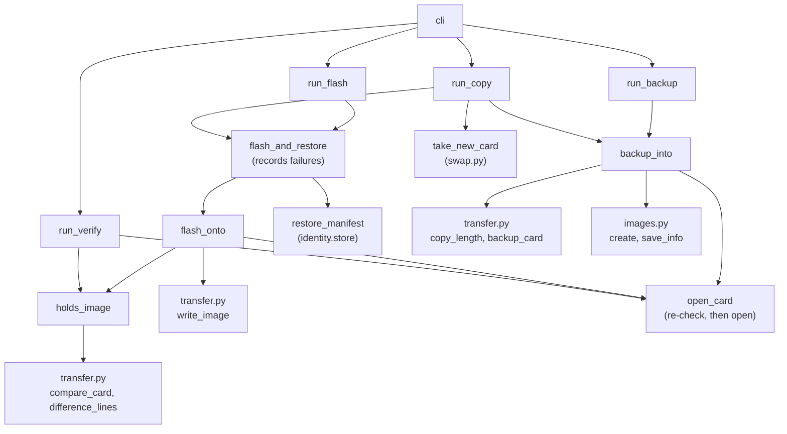
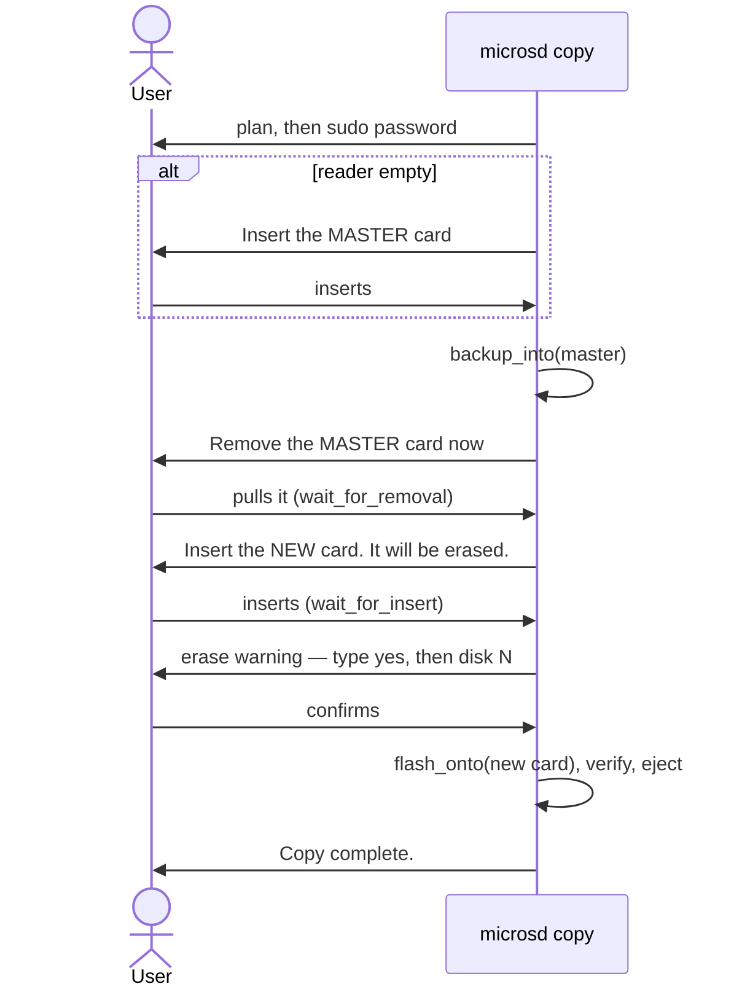

# imaging — backup, flash and copy

## Four commands, three building blocks

`imaging.py` composes the lower layers into four user-facing commands. Most of the work is in three helpers:

- **`backup_into(env, card, name)`** — unmount, find the data end, stream into a new image, save the sidecar.
- **`flash_onto(env, card, source)`** — unmount, write, then `holds_image` to verify; raise if it doesn't.
- **`holds_image(env, read_at, card, source)`** — compare the card with the image chunk by chunk and report: `Verified: OK.`, or where it differs.

`backup` is the first helper. `flash` is the second. `verify` is the third on its own, read-only. `copy` is backup and flash, with a card swap in between.

## Architecture



## The common shape of a command

Each command follows the same order, and the order is the safety design:

1. **Cheap validation** — image name free (`backup`, `copy`) or image file exists (`flash`). Fails before any disk is queried.
2. **Discovery** — find the card by fingerprint.
3. **`preflight`** — print the plan; stop for a dry run; otherwise explain and re-run under sudo.
4. **Expensive validation** — measure the image, check it fits.
5. **Identification** — `identify` the target card: its manifest, or the label ID typed by the user. (`backup` only `peek`s, and records the ID in the sidecar.)
6. **Confirmation** — erase warning plus "yes" and the identifier, for anything that writes.
7. **I/O** — through `open_card`, which re-checks the fingerprint first.
8. **Restore identity** — after a flash, write the target's own manifest back.

Anything that can refuse does so as early as possible, and always before the step that would make the refusal costly.

## Backup reads, but still unmounts

```python
def backup_into(env, card, name):
    env.diskutil.unmount_disk(card.identifier)
    with env.open_device(card, False) as device:
        length = copy_length(device.read_at, card.size_bytes, card.block_size_bytes)
        ...
```

The device is opened read-only, yet the card is unmounted first. While a FAT volume is mounted, macOS may write to it at any moment (`.fseventsd`, Spotlight indexes). An image taken mid-write could be internally inconsistent; unmounting freezes the card.

## Flash keeps the target's identity

An image carries whatever was on the *source* card's FAT partition — for a backup of a tagged master, that includes the master's manifest. Writing it to another card would give that card the wrong ID. So after verify, `restore_manifest`:

```python
def restore_manifest(env, card, manifest):
    env.diskutil.mount_disk(card.identifier)
    flashed = env.poll()
    if flashed is None:
        raise NoCardError(...)
    store(env, flashed, manifest)
    env.diskutil.eject(flashed.identifier)
```

- **`mount_disk` then re-read the card** — the partition table just changed, so the old `CardInfo` is stale. macOS does see the new partitions without reinsertion: confirmed on R2 and R4 (2026-10-21/22).
- **`env.poll()`** rather than `discover` — it is the same "card in the reader now" view `copy` uses for the swap, which keeps the flow testable with a scripted poll.
- The manifest written is the *target's*, with a `flash` (or `copy`) entry and the image name as contents. A copy can never take the master's ID: `identify` refuses it whether typed or found on the card.

## A failed flash is part of the card's history

The first real flash onto R2 wrote 62.6 GB, then the USB reader reset halfway through verify. Nothing was recorded, so R2's history said nothing about it. `flash` and `copy` now go through one wrapper:

```python
def flash_and_restore(env, card, source, before, after):
    try:
        flash_onto(env, card, source)
        restore_manifest(env, card, after)
    except Exception as error:
        record_event(env, before, after.history[-1].event, f"failed: {error}")
        raise
```

`after` is the target's manifest with this run's `flash` or `copy` event; on failure the same event kind is recorded with `failed: <error>` against `before`, then the error propagates. Stress does the same for its passes (`13-check.md`).

## Verify: a read-only second opinion

```python
def run_verify(env, image, is_dry_run):
    ...
    env.diskutil.unmount_disk(card.identifier)
    with env.open_device(card, False) as device:
        is_verified = holds_image(env, device.read_at, card, source)
    return EXIT_OK if is_verified else EXIT_ERROR
```

Same shape as `backup`: discover, show the ID, plan, sudo, unmount, open **read-only**. It never writes a manifest or a history entry. When chunks differ, `holds_image` prints `difference_lines` — how many chunks, which partitions, and a note when every difference is in a FAT partition, which is what a macOS mount does (`10-transfer.md`). On R2 after `make card` writes, that was the result: 9 chunks, all FAT32, Linux root identical.

## Copy: the guided flow



Details that matter:

- **The image is kept.** If the user declines at the last step, the message says the image is saved under its name — `flash` can make the copy later without the master.
- **The master is unmounted, not ejected**, so the removal wait truly waits for a physical pull (see `11-swap.md`).
- **No deadline on the swap.** The backup takes ~17 minutes, so each wait prints `(Waiting as long as it takes; Ctrl-C to stop.)` (`WAITING`) and lasts until the swap happens.
- **A look-alike warning.** If the new card has the same size and partition layout as the master, the tool prints a CAUTION. The comparison uses partition *types and sizes* only:

```python
def layout(card):
    parts = tuple((part.content, part.size_bytes) for part in card.partitions)
    return card.size_bytes, parts
```

Identifiers (`disk4s1` → `disk5s1`) and mount points change every time a card is inserted, so including them would make a re-inserted master look different — a bug caught in review and pinned by a regression test.

## Observations and possible improvements

1. **Several copies from one backup.** The spec chose one copy per run; `flash` covers the rest. A `--copies N` loop over the swap/flash half would be a small addition if wanted.
2. **Resume after a failed flash.** A failed verify leaves the image intact; the message could suggest `make flash IMAGE=<name>` to retry with the same or another card. Likewise a `copy` stopped at the swap leaves its image saved, but rerunning `copy` backs the master up again; `flash` from the saved image is the shortcut.
3. **Card size versus image size.** A Pi image flashed to a larger card leaves the extra space unpartitioned until Pi OS expands its root filesystem on first boot. Worth a line in the README.
4. **`verify` exits 1 for FAT-only differences**, so `make` prints `Error 1` for a card that is fine. A separate exit code (or 0 with the note) would let scripts tell the two apart.
