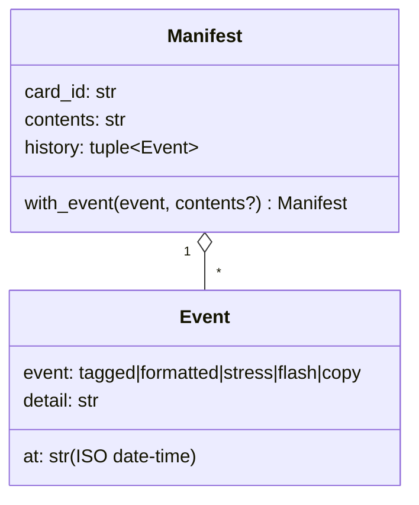

# manifest — a card's identity on paper

## Why it exists

MicroSD cards look identical and get mixed up. Each physical card carries a **sticker with a 1–4 character ID** (`A1`, `PI7`), and this module is the data model behind it:

- the **manifest** a card carries about itself;
- the **registry** in the repo listing every card ever seen.

It is pure: JSON in, JSON out, files in a directory it is given. Finding and mounting the card's volume is `identity.py`'s job (`17-identity.md`).

## The data



On the card it is `.microsd_tools/manifest.json`:

```json
{"id": "A1", "contents": "raspios-lite",
 "history": [{"at": "2026-10-20T14:05:00", "event": "flash", "detail": "raspios-lite"}]}
```

Some design choices:

- **Immutable dataclasses.** `with_event` returns a new manifest. A command builds the manifest it *will* write (`identify`), then adds the event once the operation has succeeded. If an exception interrupts it, nothing half-updated is left lying around.
- **History is append-only.** Nothing edits or removes entries, so the file is a log of what happened to that piece of plastic.
- **Timestamps are strings.** They're produced once from the injected `Env.now` and only ever displayed, so parsing them back into `datetime` would buy nothing.

## Validating at the boundary

IDs come from a human reading a sticker, so they are validated once, where they enter:

```python
ID_RE = re.compile(r"[A-Z0-9]{1,4}")

def parse_id(text: str) -> str:
    card_id = text.strip().upper()
    if not ID_RE.fullmatch(card_id):
        raise IdentityError(f"bad card ID {text!r}: use 1-4 letters or digits")
    return card_id
```

**Upper-casing is a defined rule, not a repair.** Labels are case-insensitive by design, so `a1` and `A1` are the same card. The ID also becomes the FAT volume name after `stress`, and FAT labels are upper case anyway.

`from_dict` runs every field through the same checks, `parse_id` and `make_event`. A manifest with an unknown event or a bad ID raises `IdentityError` naming the file.

## Never silently replace

> A malformed manifest raises; it is never overwritten.

The tempting fallback, "can't parse it, so treat the card as untagged", would ask for an ID and then **overwrite the card's history**. Raising makes the user look at the file. This is the style guide's *report, don't repair* rule applied to persisted data.

## Atomic write on a card that can be pulled

```python
def write_manifest(volume, manifest):
    path = manifest_path(volume)
    path.parent.mkdir(exist_ok=True)
    partial = path.with_suffix(".partial")
    partial.write_text(json.dumps(to_dict(manifest), indent=2) + "\n")
    partial.replace(path)
```

This is the classic **write-temp-then-rename** pattern, the same one the image store uses for `.partial` images. On FAT a rename isn't journaled, so a pull at exactly the wrong moment can still corrupt the directory. But the common failure, a pull mid-write, leaves the old manifest intact instead of a truncated one.

## The registry

`Registry` keeps `.microsd_tools/cards.json` at the repo root (git-ignored), keyed by ID:

```json
{"A1": {"id": "A1", "contents": "...", "history": [...], "last_seen": "2026-10-20T14:05:00"}}
```

- **`record` is an upsert.** The card's own manifest is the latest truth, so its entry replaces the registry's wholesale. The registry is a cache with a memory, not a second source of truth to merge.
- **`lookup` is what makes re-tagging useful.** A card wiped on another machine comes back untagged; typing its ID finds its old history (see `identify`).
- **Ownership** goes through `images.give_to_owner`, shared with the image store, so a registry created under `sudo` stays editable by the user.

## Observations and possible improvements

1. **No locking.** Two `microsd` processes recording at once could lose an update. Only one reader exists, so this isn't reachable today.
2. **The registry is rewritten whole on every record.** That's fine for tens of cards. It would matter only at a scale this tool won't reach.
3. **`EVENTS` is a tuple of strings.** An `Enum` would let the type checker catch a misspelled event at the call site rather than at runtime in `make_event`.
4. **Registry and card can diverge** if a card is modified on another machine. `last_seen` shows how stale an entry is, but nothing flags a conflict.
