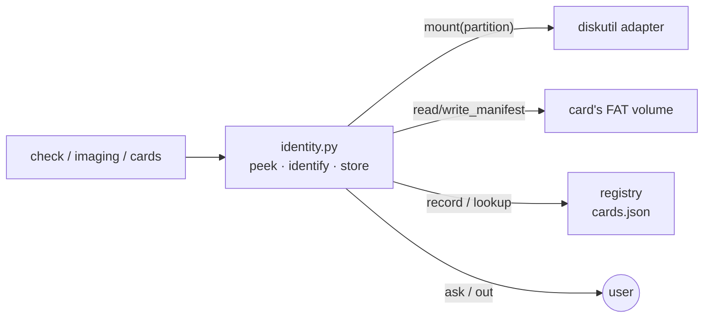
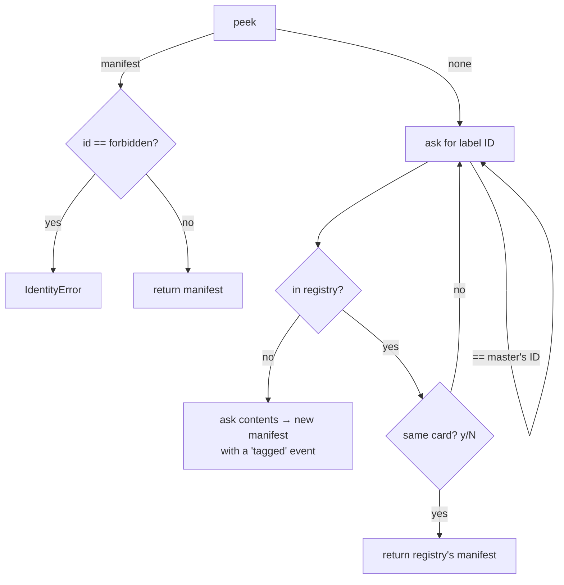

# identity — which card is this?

## Role

`manifest.py` defines what a card identity *is*. This module answers **"which card is in the reader?"** for every command, and makes sure the answer survives an overwrite. It sits between the commands and three resources:



## Why the FAT partition

macOS can write FAT but not ext4, and a Raspberry Pi card is a FAT `bootfs` plus an ext4 root. So the manifest lives on the FAT volume:

```python
FAT_CONTENTS = (
    "DOS_FAT_32",
    "Windows_FAT_32",
    "DOS_FAT_16",
    "Windows_FAT_16",
    "Microsoft Basic Data",
)
```

`card_volume` picks the first partition with one of these types, mounts it through the adapter, and returns the mount point. If there are several, it says which one it used.

**Assumption to verify:** factory exFAT cards may report a different content type (`Windows_NTFS` on MBR). Such a card would read as "no FAT" until it is formatted or flashed.

## Three operations, three levels of commitment

| Function | Asks the user? | Writes the card? | Used by |
|---|---|---|---|
| `peek` | no | no | validate, backup, plan lines |
| `identify` | if untagged | no | stress, flash, copy, card |
| `store` | no | yes | after stress/flash/copy, card |

Splitting them this way keeps **read-only commands read-only**: `validate` can show the ID without any path that might prompt or write.

## identify: asking for a label



A few things here aren't obvious from the code:

- **Bounded retries (`ID_TRIES = 3`).** A loop "until valid" would hang forever on a closed stdin, and in tests on a script that ran out of answers. Three wrong answers raise instead.
- **The registry confirmation** recovers a card's history after it was wiped elsewhere. A "no" means the sticker and the registry disagree, which is worth stopping on, so the user is asked again rather than the entry being overwritten.
- **`forbidden_id`** is how `copy` keeps the master's ID off the new card. It is enforced both ways: when the ID is typed, and when it is already on the card's manifest.

## store: re-check, then write

```python
def store(env, card, manifest):
    recheck(env.diskutil, env.fingerprint, card)
    volume = card_volume(env, card)
    if volume is None:
        env.out("WARNING: ... recorded in the registry only, not on the card.")
    else:
        write_manifest(volume, manifest)
    env.registry.record(manifest, stamp(env))
```

- **`recheck` first**, the same rule as before any raw I/O: the identifier must still be the fingerprinted card. The partition written to comes from that card's own partition list, so the volume belongs to the card.
- **No FAT volume is a warning, not an error.** An image with no FAT partition is legitimate. The event still lands in the registry, so the history isn't lost.

## Observations and possible improvements

1. **The mount point isn't cross-checked against the disk.** We trust that `diskutil mount diskNsM` returns that partition's mount point. Comparing `diskutil info`'s `ParentWholeDisk` would close that gap cheaply.
2. **`peek` writes the registry.** That's intended ("seen"), but it means `validate` touches a repo file. A `--no-record` mode isn't needed yet.
3. **The FAT type list is empirical.** TF04.10 should record the content types the real reader reports for factory, Pi and freshly formatted cards.
4. **`event()` and `stamp()` are thin helpers.** They exist so every timestamp comes from `Env.now` in one format.
