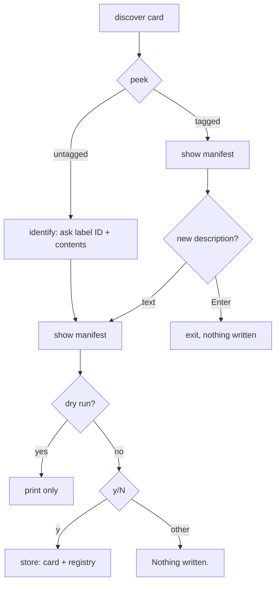

# cards — `microsd card` and `microsd history`

## What they are for

These two commands are the user's window onto card identity:

- **`make card`** — "what is this card?" Shows the ID, contents and history of the card in the reader. An untagged card gets tagged; a tagged one can have its description updated.
- **`make history`** — "what cards do we have?" One line per card in the registry.

## No sudo needed

Unlike every other command, these never open the raw device. The manifest is an ordinary file on a volume macOS has mounted for the user, and the registry is a repo file. So there is **no `preflight` and no re-run under sudo**, and no password prompt just to look at a card.

*Unverified:* this assumes macOS mounts removable FAT volumes writable by the console user, which is the default. If it isn't, writing raises `OSError`, which the CLI reports.

## `card`: one flow, two branches



Both branches end in the same "show, then confirm" step. Tagging writes to the card, so the user sees exactly what will be written before answering **`y/N`**. The default is no. This is the lighter `is_yes`, not the two-step erase confirmation: nothing is destroyed.

`update_contents` uses `dataclasses.replace` to change only the description. The history is left as it is, since a description change isn't an event on the card.

## `cards`: the registry at a glance

```
A1    raspios-lite              last: flash 2026-10-20T14:05:00  seen: 2026-10-20T14:05:00
B2    empty                     last: stress 2026-10-21T09:12:44  seen: 2026-10-21T09:12:44
```

Fixed-width ID and contents columns keep a list of tens of cards readable in a terminal. Cards appear sorted by ID, the order of the stickers.

## Observations and possible improvements

1. **No way to fix a mistyped ID.** Once a card is tagged, `card` only edits the description. A rename would need to move the registry entry too.
2. **`cards` shows registry data only.** A card modified elsewhere shows its last known state; `seen` hints at staleness.
3. **Description edits don't add history.** If knowing *when* a description changed matters, a `noted` event would be the natural addition.
